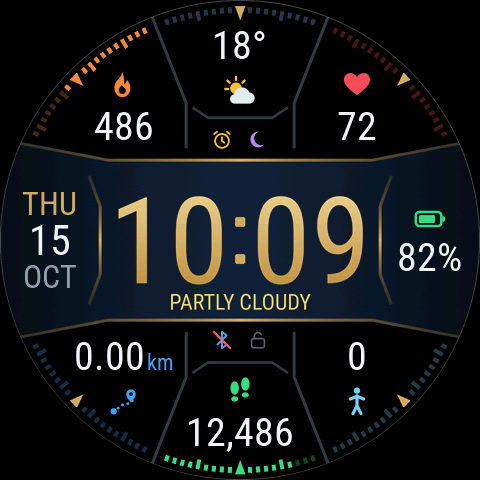
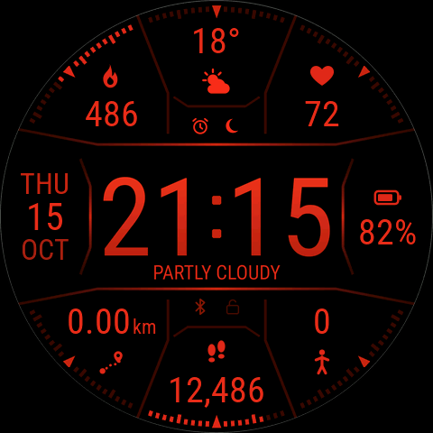
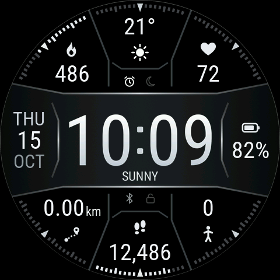
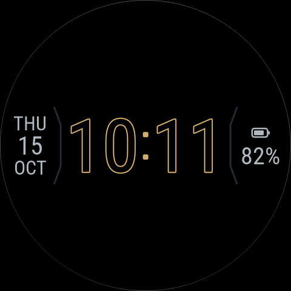
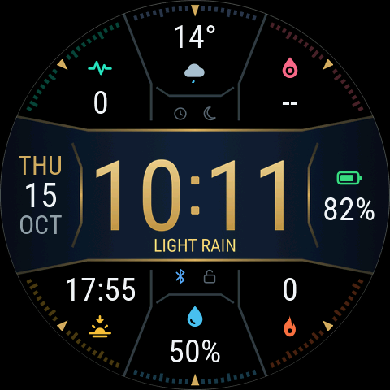
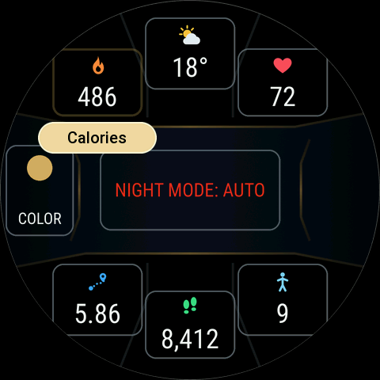

# Sextant

A nautical, data-rich watch face for the **Amazfit Balance 3** (480×480 round, Zepp OS). It also runs, scaled, on the 466×466 round watches (Zepp OS API level 4.2 or later).

A navy and brass time bar runs across the middle. Six complications sit around it, and each section's progress shows as compass-style ticks on the bezel. The time stays readable at a glance, and the data stays readable without squinting.

<p align="center"></p>

## Install


1. In the **Zepp app**, turn on Developer Mode: **Profile → Settings → About**, then tap the Zepp logo 7 times.
2. Go to **Profile → your watch → Developer Mode** and tap the **scan** icon (top right).
3. Scan this QR code and confirm.

The QR code always installs the latest release (see the [changelog](CHANGELOG.md)). You can also download `sextant.zpk` from the [install page](https://raetha.github.io/zepp-watch-faces/) or from the [releases](https://github.com/raetha/zepp-watch-faces/releases).

<br clear="right">

## Modes and styles

| Day (default) | Night (automatic, sunset → sunrise) | Mono theme |
| :---: | :---: | :---: |
|  |  |  |
| **Always-on** | **Other complications** | **Edit mode** |
|  |  |  |

All screenshots are taken on the real Zepp OS firmware (Amazfit Balance 2 emulator image). The emulator can't feed test values to some sensors (distance, PAI, stand, fat burning, blood oxygen, stress, training, barometer, body temperature, compass), so those show 0 or -- in the screenshots.

## Features

- **Time:** a large, fixed-width time that never shifts sideways. Follows your 12/24-hour setting (no AM/PM by design). No seconds.
- **Weather:** the current condition's icon and temperature at the top (a complication, so it can move or be swapped), with the condition's name under the time (shown whenever a complication shows weather).
- **Battery:** icon and percentage on the right. The icon fills with the charge, emptying a pixel at a time (about every 5%), and turns orange at 40% and red at 20%. At 0% only the outline is left.
- **Date:** weekday, day and month on the left of the time bar.
- **Status icons** beside the time bar: alarm and Do Not Disturb above it, Bluetooth and screen lock below it. Each slot always shows something: a blue Bluetooth icon while connected (a red slashed one when disconnected), and a dim outline for the others that lights up in colour when that mode is on.
- **Six editable complications.** Long-press the face → **Edit**, then tap any section. Choices:
  - activity: steps, distance (km or mi, following your watch setting), calories, floors climbed, stand, fat-burning minutes, PAI
  - body: heart rate, resting heart rate, blood oxygen, stress, body temperature, sleep, sleep score
  - training: VO2 max, training load, recovery time
  - outdoors: weather, today's forecast (high/low), UV index, humidity, air quality, altitude, air pressure, compass heading
  - sky: next sunrise or sunset, moon phase
  - Tap a complication to open its app (heart rate, weather, sleep and so on).
  - In the editor, swipe up or down on a selected section (or turn the crown) to scroll through the choices.
- **Progress ticks:** goal-based metrics light up their section's ticks. Compass markers at north, south and the diagonals stay brass until a gauge's progress reaches them, then light in its colour.
- **Night mode:** everything switches to deep red on pure black between sunset and sunrise, using your weather location's sun times. Turn it off in Edit mode (tap the time).
- **Mono theme:** an all-white-on-black version, friendly to colour-blind users. Pick it in Edit mode (tap the date).
- **Always-on display:** outline digits with the date and battery on black, to save battery. The time stays where it is on the normal screen.

Every metric has its own icon shape, so colour is never the only cue. Day-mode text meets WCAG contrast guidelines.

## Development

Sextant lives in the [zepp-watch-faces](../../README.md) collection. For the shared workflow, see [`docs/development.md`](../../docs/development.md); for this face's design rationale, see [`docs/design.md`](docs/design.md).

```bash
python3 faces/sextant/design/generate.py   # regenerate this face's images + layout
node tools/harness/run_scenarios.mjs sextant
```

## License

This face (everything in `faces/sextant/`) is licensed under [CC BY-NC-SA 4.0](LICENSE): share and remix it non-commercially with credit, but don't sell it. The name "Sextant" isn't licensed for reuse. The shared tooling it builds on is MIT, and the fonts are under the SIL Open Font License. See the repository [LICENSE](../../LICENSE).
