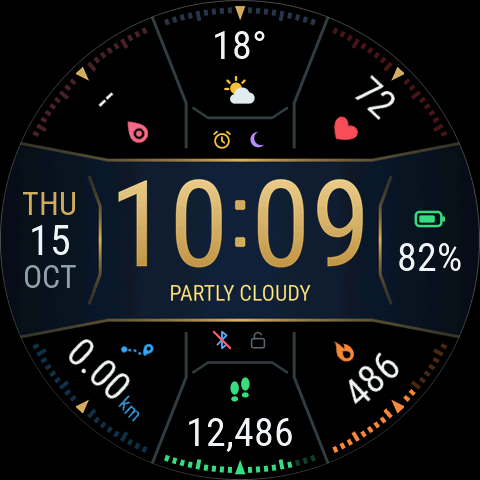
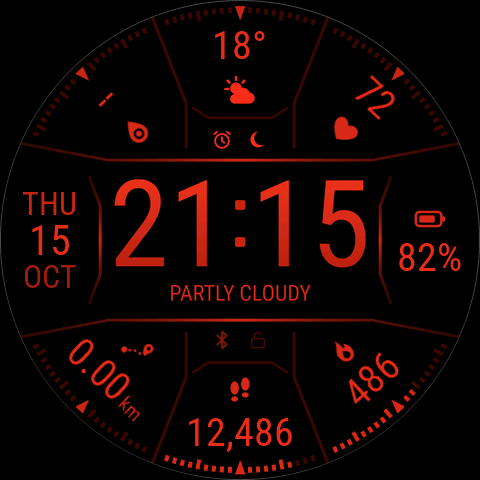
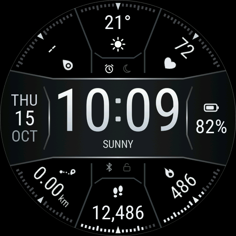
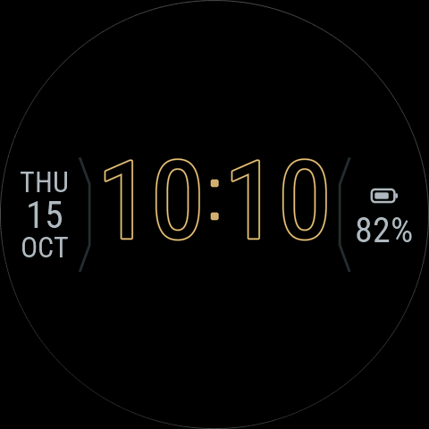
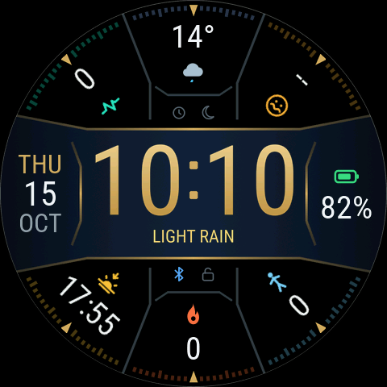
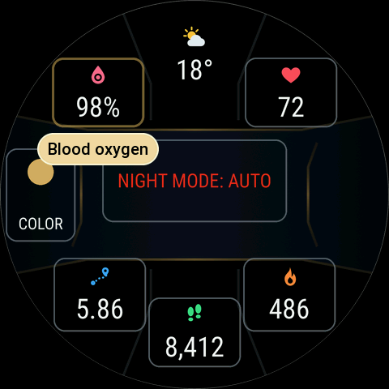

# Twisted Sextant

[Sextant](../sextant/) with a twist, for the **Amazfit Balance 3** (480×480 round, Zepp OS). The four corner complications turn to run along their bezel gauges: the value sits at the rim and the icon points in towards the centre, like the top and bottom sections. Text always stays the right way up to read.

<p align="center"></p>

> **Draft.** Twisted Sextant isn't released yet. Install the DEV test build from the [test-build page](https://raetha.github.io/zepp-watch-faces/dev/).

## How it differs from Sextant

- **Turned corners.** The face draws each corner value from one image per character and the watch turns them, so only metrics the face can read itself can turn. The diagonal compass markers sit at the middle of each corner gauge, pointing at the value.
- **22 metrics to choose from** in every editable slot: steps, distance, calories, stand, fat-burning minutes, PAI, heart rate, resting heart rate, blood oxygen, stress, body temperature, sleep, sleep score, VO2 max, training load, recovery time, today's forecast, altitude, air pressure, compass heading, next sunrise or sunset, and moon phase. Floors, current weather, UV index, humidity and air quality aren't offered in the slots, because the watch fills those in itself and they can't turn.
- **Weather is fixed at the top** (current condition icon and temperature, with the condition's name under the time). It isn't editable.
- **Defaults:** blood oxygen top left, heart rate top right, distance bottom left, steps bottom centre, calories bottom right.

Everything else is Sextant: the time bar, date and battery, status icons, compass-tick gauges, automatic night mode, the mono theme and the always-on display.

## Modes and styles

| Day (default) | Night (automatic, sunset → sunrise) | Mono theme |
| :---: | :---: | :---: |
|  |  |  |
| **Always-on** | **Other complications** | **Edit mode** |
|  |  |  |

All screenshots are taken on the real Zepp OS firmware (Amazfit Balance 2 emulator image). The emulator can't feed test values to some sensors (distance, PAI, stand, fat burning, blood oxygen, stress, sleep, training, barometer, body temperature, compass), so those show 0 or -- in the screenshots.

## Development

Twisted Sextant has no design or face code of its own. `design/generate.py` runs Sextant's generator with the overrides in `design/variant.json` and writes this face's assets and layout, and `watchface/index.js` runs Sextant's face code (`faces/sextant/watchface/sextant.js`) with that layout. A change to Sextant's design or code applies to both faces.

```bash
python3 faces/twisted-sextant/design/generate.py
node tools/harness/run_scenarios.mjs twisted-sextant
```

## License

This face (everything in `faces/twisted-sextant/`) is licensed under [CC BY-NC-SA 4.0](LICENSE), like Sextant. The shared tooling it builds on is MIT, and the fonts are under the SIL Open Font License. See the repository [LICENSE](../../LICENSE).
